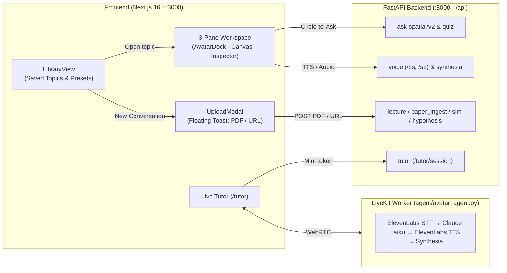

# ScholarTwin — System & UI Design

ScholarTwin is a multimodal AI research and learning workspace built around three interactive modes—**LectureGraph**, **Paper2Sim**, and **HypothesisGraph**—paired with **Circle-to-Ask** spatial tutoring and a live **Synthesia + LiveKit** avatar tutor.

---

## 1. High-Level Architecture

---

## 2. Frontend Design (`frontend/src/`)

### 2.1 Entry & Navigation Flow
The root route `/` ([page.tsx](file:///Users/ashutosh/Developments/Competitions/Imperial%20AI%20Hackathon/Imperial_AI_Hack/frontend/src/app/page.tsx)) manages two top-level views via `view: "library" | "workspace"`:

1. **Library Landing View** ([LibraryView.tsx](file:///Users/ashutosh/Developments/Competitions/Imperial%20AI%20Hackathon/Imperial_AI_Hack/frontend/src/components/LibraryView.tsx))
   - Displays saved conversations and seeded starter topics (`DEFAULT_LIBRARY_TOPICS`) in a responsive card grid.
   - Each card shows the mode badge (`LectureGraph`, `Paper2Sim`, `HypothesisGraph`), title, subtitle, last tutor reply preview, source type (`pdf`, `url`, or `preset`), and UTC date (`formatTopicDate`).
   - Persists user topics in `localStorage` (`scholartwin.library.v1`) via `useSyncExternalStore` to avoid SSR/client hydration mismatches and `Date.now()` prerender issues.
   - Header provides **Library** and **New Conversation** tabs, plus a **Live Tutor** link (`/tutor`).

2. **New Conversation Floating Toast** ([UploadModal.tsx](file:///Users/ashutosh/Developments/Competitions/Imperial%20AI%20Hackathon/Imperial_AI_Hack/frontend/src/components/UploadModal.tsx))
   - Triggered from the **New Conversation** tab in either the Library or Workspace header.
   - Anchored as a floating bottom-right toast dialog (`fixed bottom-5 right-5 z-50`) with:
     - **Mode selector:** `LectureGraph`, `Paper2Sim`, `HypothesisGraph`
     - **PDF drag-and-drop / file picker**
     - **arXiv ID / URL input**
   - On successful ingest, the resulting `WorkspaceDataset` is prepended to the library and opened immediately in the 3-pane workspace.

3. **3-Pane Workspace** ([page.tsx](file:///Users/ashutosh/Developments/Competitions/Imperial%20AI%20Hackathon/Imperial_AI_Hack/frontend/src/app/page.tsx))
   - **Left Pane (`290px`):** `AvatarDock` with `LiveAvatarTile`, text/voice prompt input, TTS toggle, and upload trigger.
   - **Center Pane (`1fr`):** Mode-specific interactive canvas:
     - `GraphCanvas` for `lecture` and `hypothesis` modes (prereq/supports/contradicts/gap edges, node selection, annotation pulses).
     - `PaperSimCanvas` for `paper2sim` mode (interactive plots + parameter sliders).
     - `LassoOverlay` for **Circle-to-Ask** bounding-box capture.
   - **Right Pane (`320px`):** `InspectorPane` showing selected node details, connected edges, or simulation equations/parameters.

### 2.2 API Client & Data Adapters
- [endpoints.ts](file:///Users/ashutosh/Developments/Competitions/Imperial%20AI%20Hackathon/Imperial_AI_Hack/frontend/src/api/endpoints.ts): Typed wrappers for `/api/*` endpoints.
- [fixtures.ts](file:///Users/ashutosh/Developments/Competitions/Imperial%20AI%20Hackathon/Imperial_AI_Hack/frontend/src/api/fixtures.ts): Loads `/fixtures/{lecture_graph,hypothesis_graph,sim_heavy_ball}.json` for offline/preset mode initialization.
- [adapters.ts](file:///Users/ashutosh/Developments/Competitions/Imperial%20AI%20Hackathon/Imperial_AI_Hack/frontend/src/api/adapters.ts): Maps backend `Graph` and `SimSpec`/`SimOutput` schemas onto the frontend `WorkspaceDataset` shape (`graphToWorkspaceDataset`, `simSpecToWorkspaceDataset`, `simOutputToSeries`).

---

## 3. Backend API Design (`backend/app/`)

[main.py](file:///Users/ashutosh/Developments/Competitions/Imperial%20AI%20Hackathon/Imperial_AI_Hack/backend/app/main.py) (`create_app()`) auto-discovers packages under `app.modules/*` and mounts each router under `/api`:

| Module | Key Routes | Purpose |
| :--- | :--- | :--- |
| `lecture` | `POST /api/ingest/lecture`, `GET /api/graphs/{graph_id}`, `GET /api/docs/{doc_id}/pages/{n}.png` | Lecture PDF ingestion, concept graph retrieval, and page rendering |
| `paper_ingest` | `POST /api/ingest/paper`, `GET /api/ingest/paper/{paper_id}` | Paper PDF / URL / arXiv ID ingestion |
| `sim` | `POST /api/sim/generate`, `POST /api/sim/generate-pdf`, `POST /api/sim/run`, `GET /api/sim/{sim_id}` | Sandboxed simulation codegen and live parameter execution |
| `hypothesis` | `POST /api/topics`, `GET /api/papers/{paper_id}` | Multi-paper claim/gap graph generation |
| `ask` | `POST /api/ask-spatial/v2` | Spatial Circle-to-Ask reasoning with segmented UI annotations |
| `quiz` | `GET /api/quiz/{graph_id}/next`, `GET /api/quiz/{graph_id}/{node_id}`, `POST /api/quiz/{graph_id}/{node_id}/answer`, `GET /api/mastery/{graph_id}` | Adaptive MCQ generation and mastery tracking |
| `voice` | `POST /api/tts`, `POST /api/tts/segments`, `POST /api/stt`, `GET /api/media/{media_id}` | ElevenLabs TTS/STT and audio serving |
| `synthesia` | `POST /api/avatar/clips`, `POST /api/avatar/session`, `GET /api/avatar/clips/{clip_id}/video` | Synthesia avatar clip generation and playback |
| `tutor` | `GET /api/tutor/tutors`, `POST /api/tutor/session` | LiveKit room token minting and agent dispatch |
| `presets` | `GET /api/presets`, `POST /api/presets/{name}/load`, `POST /api/presets/{name}/freeze` | Demo preset management |
| `health` | `GET /api/health` | Service health, cache mode, and active preset status |

---

## 4. Live Avatar Worker (`agent/avatar_agent.py`)

[avatar_agent.py](file:///Users/ashutosh/Developments/Competitions/Imperial%20AI%20Hackathon/Imperial_AI_Hack/agent/avatar_agent.py) runs as a LiveKit Agents worker (`scholartwin-tutor`):
- **Pipeline:** Silero VAD → ElevenLabs STT (`scribe_v2_realtime`) → Anthropic Claude (`claude-haiku-5-5`, prompt caching) → ElevenLabs TTS (`eleven_flash_v2_5`) → Synthesia avatar (`MAX_AVATARS = 5`, swappable mid-call via `tutor.switch` text stream).
- **Turn Handling:** Configured for natural interruptions (`min_duration: 0.8s`, `min_words: 2`) and word-synced transcripts (`use_tts_aligned_transcript=True`).

---

## 5. Configuration & Runtime

- **Environment Variables ([settings.py](file:///Users/ashutosh/Developments/Competitions/Imperial%20AI%20Hackathon/Imperial_AI_Hack/backend/app/settings.py), [.env.example](file:///Users/ashutosh/Developments/Competitions/Imperial%20AI%20Hackathon/Imperial_AI_Hack/.env.example)):**
  - Backend loads `<repo_root>/.env` and `backend/.env` via `pydantic-settings` (`load_settings()`).
  - Agent loads `agent/.env` first, then `<repo_root>/.env`.
- **Local Startup ([start.sh](file:///Users/ashutosh/Developments/Competitions/Imperial%20AI%20Hackathon/Imperial_AI_Hack/start.sh)):**
  - Starts FastAPI (`uv run uvicorn app.main:app --reload --port 8000`) and Next.js (`npm run dev` on `:3000`) with `trap` cleanup.
