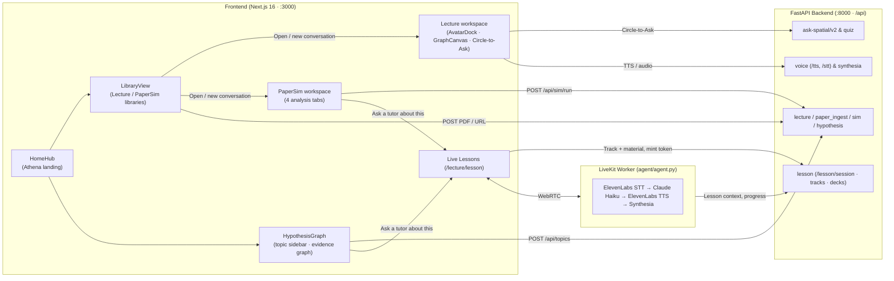

# Athena — System & UI Design

Athena is a multimodal AI research and learning workspace. It has three modules, **LectureUnderstanding**, **PaperSim** and **HypothesisGraph**, plus **Circle-to-Ask** spatial tutoring and a live **Synthesia + LiveKit** avatar tutor.

---

## 1. High-Level Architecture



---

## 2. Design Language

The visual system lives in [globals.css](frontend/src/app/globals.css). Motion and material guidance comes from [SKILL.md](SKILL.md) (Apple's fluid-interface principles, translated for the web). This section describes how the app uses both today.

### 2.1 Principles

- **One hue per module.** Every screen of a module uses its colour for the header icon, back-button hover, primary buttons and glows, so you always know where you are (§2.3).
- **Liquid Glass.** Every screen sits on a static colour field (`--backdrop-field`, painted once on `body`). Content and controls float above it as translucent glass layers. Each layer has a bright rim, an inner top highlight and a diagonal sheen. The header is a floating capsule, panes are floating sheets inset with ~10 px gaps, and single-line controls are capsules. Screen roots stay transparent so the field shows through.
- **Calm surfaces, expressive entrances.** The expression comes from motion: things fade up in a stagger, graphs draw themselves, cards lift on hover. The colour field behind stays still.
- **Ask a tutor about this.** The tutor is not in the header.
  - **Where the button appears:** only the inner workspaces, the PaperSim tabbed workspace and the HypothesisGraph results view, carry **Ask a tutor about this** ([AskTutorButton](frontend/src/tutor/AskTutorButton.tsx)) in their content, where it never covers content at any scroll position.
  - **Where it does not:** the landing page, the libraries and the HypothesisGraph start screen have none. LectureUnderstanding is the live lesson itself (`/lecture/lesson`).
  - **Click:** it reuses the learning track already made for that paper or map, or creates one with it as the material (a paper's concept map, or the map's claims with their supports / contradicts / open-question links), then opens the lesson lobby on it (`/lecture/lesson?track=<id>`), where the student picks a tutor and joins. While it works the capsule reads "Setting up your lesson…"; a failure shows a short reason under it.
- **Show the paper's meaning, not the plumbing.**
  - Math always renders, as KaTeX or Unicode.
  - Graph links say how things relate, never a generic "governs".
  - A sidebar entry stays readable even when collapsed.
- **Speak only when asked.** The tutor and avatar stay silent until the user asks for help. Loading a paper or topic never triggers speech.
- **Every state is themed and accessible.** This holds in light, dark and high contrast, for colour-vision deficiency, with reduced motion, and from a 390 px phone to a wide desktop.

### 2.2 Themes and tokens

The app has three themes, set as `data-theme` on `<html>`: **light** (default), **dark** and **contrast**.
- [ThemeProvider](frontend/src/components/ThemeProvider.tsx) owns the state; the choice is stored in `scholartwin.theme.v2`.
- A `beforeInteractive` bootstrap script in [layout.tsx](frontend/src/app/layout.tsx) applies the theme before first paint.
- The **ThemeToggle** sits in every header.

**Never hard-code colours.** Use tokens through Tailwind arbitrary values (`bg-[var(--bg-surface)]`) or inline `style`. For tints, use `color-mix(in srgb, <token> N%, transparent)`.

| Family | Tokens | Use |
| :--- | :--- | :--- |
| Backgrounds | `--bg-canvas`, `--bg-surface`, `--bg-surface-solid`, `--bg-surface-muted`, `--bg-glass`, `--bg-glass-elevated`, `--backdrop-field` | Opaque base colour; cards and panels (translucent thick glass, ~0.66); the opaque fallback; wells and inputs (a faint ink wash); thin glass bars; popovers; the colour field behind every screen |
| Glass | `--glass-rim`, `--glass-highlight`, `--glass-lowlight`, `--glass-specular`, `--glass-specular-2`, `--glass-blur` | Rim border, inner top and bottom light, diagonal sheen, blur radius (0 in contrast) |
| Borders | `--border-subtle`, `--border-strong` | Default hairlines; emphasis, dashed empty states, hover |
| Text | `--text-primary`, `--text-secondary`, `--text-muted` | Each is ≥ 4.5:1 on canvas, surface and surface-muted in every theme |
| Accent | `--accent`, `--accent-hover`, `--accent-soft`, `--accent-border`, `--accent-fg` | Primary actions and the lecture module. `-fg` is the text colour on a solid fill of *any* module hue |
| Status | `--status-{support,contradict,gap,warning}` plus `-soft` and `-border` (and `--status-contradict-fg`) | Evidence semantics and module hues (Okabe-Ito based, CVD-safe; light-theme shades darkened to stay ≥ 4.5:1 on their own tint) |
| Elevation | `--shadow-card`, `--shadow-card-hover`, `--shadow-elevated`, `--hero-glow` | Cards, floating panels, hero glow |
| Graph | `--xy-*` (mapped from the tokens above) | React Flow controls, edges and minimap follow the theme |

**Glass rules.** Text sits only on thick glass (`--bg-surface`, `apple-card`, `apple-sheet`, `apple-glass-elevated`), and never more than two glass layers are stacked over text. Don't put `backdrop-filter` or a transform on an element that contains `position: fixed` children, because it becomes their containing block and clips them. Cards and sheets therefore have no blur; only bars and popovers do. Never animate or leave a `filter` on a glass element (even `blur(0)`), because Chromium then stops rendering its backdrop blur. Write only `backdrop-filter` in CSS; the build adds the `-webkit-` prefix, and writing both by hand made it drop the standard one. **Reduced transparency** and **more contrast** swap every glass fill for `--bg-surface-solid` and drop the colour field.

**High contrast** turns glass into solid surfaces, removes blur, aurora, grid and sheen, and makes borders opaque. It also swaps the rotating glow border for a static ring and thickens focus outlines.

### 2.3 Module hues and evidence colours

| Module / meaning | Token | Icon (lucide) |
| :--- | :--- | :--- |
| LectureUnderstanding · prerequisite edges · primary actions | `--accent` | `Layers` |
| PaperSim · **supports** edges | `--status-support` | `Activity` |
| HypothesisGraph · **research gap** edges (dashed) | `--status-gap` | `GitCompare` |
| **Contradicts** edges (dash-dot, so it doesn't rely on hue alone) | `--status-contradict` | |
| Warnings, pulsed nodes | `--status-warning` | |
| Live Tutor | `--accent` | `GraduationCap` |

Evidence counts always appear as coloured dot plus number, using the same three colours. Examples are the HypothesisGraph stat chips, the sidebar rows and the collapsed-card evidence bar.

### 2.4 Typography

- **Font:** Geist and Geist Mono, self-hosted with `next/font` in [layout.tsx](frontend/src/app/layout.tsx) (`--font-geist`, `--font-geist-mono`), with the system SF stack as fallback. `html { font-size: 17.5px }`. Every `rem` is therefore 17.5 px, so use `px` where an exact pixel size matters (sidebar widths, for example).
- **Classes:**
  - `apple-display`: large tight titles.
  - `apple-heading`: section and card titles.
  - `apple-label`: 10–11 px uppercase tracked labels such as "PREVIOUS TOPICS" and "CHOOSE A WORKSPACE".
- **Scale:**
  - The landing wordmark is `text-5xl sm:text-7xl`.
  - Hero headlines are `text-2xl sm:text-3xl`.
  - Header titles are `text-sm` bold.
  - Body text is `text-xs`/`text-sm`.
  - Metadata is 10–11 px.
- **Gradient text** (`bg-clip-text`) always gets `pb-1.5`/`pb-2` and `leading-[1.15–1.25]`, so descenders aren't clipped.
- **Math:**
  - [MathTex](frontend/src/components/math/MathTex.tsx) `Tex` / `RichText` render KaTeX, including `$…$`, `\(…\)` and auto-detected math in prose.
  - `prettyMath` turns LaTeX/ASCII into Unicode for places that can't hold markup: `<option>`, SVG, `title` and headers.

### 2.5 Surfaces, shape and elevation

| Class | Where |
| :--- | :--- |
| `apple-glass` | Thin glass with blur: the header capsule, floating legends, overlay captions, chips over content |
| `apple-glass-elevated` | Thick glass with blur: popovers, bubbles, the New Conversation panel, sidebar peeks, the Live Tutor panel |
| `apple-sheet` | Floating panes that hold lists of text (sidebars, side panels, docks); thick glass, no blur |
| `apple-card` | Glass cards (home modules, library tiles, legend cards); hover raises the shadow |
| `apple-seg` / `apple-seg-on` | Segmented controls: a recessed track with one raised glass segment (tabs, the theme toggle) |
| `apple-tint` | Tinted glass for the one primary action in a view. Set the hue with `--tint` (default `--accent`); text uses `--accent-fg` |
| `apple-press` | Every pressable control; it scales down on pointer-down for instant feedback |
| `apple-focus` | Every focusable control; visible focus ring (thicker in contrast) |

- **Radii:** Tailwind's scale is remapped in `globals.css`: `rounded-lg` 12 px, `xl` 16 px, `2xl` 22 px, `3xl` 28 px.
  - `rounded-full` (capsules) for single-line buttons, chips, inputs and tab tracks.
  - `rounded-[22px]` / `2xl` for floating sheets and cards.
  - The header capsule is `rounded-[28px]`.
- **Borders:** glass surfaces carry a 1 px `--glass-rim`, and wells and inputs `--border-subtle`. Hover moves a border to the module's `-border` token or to `--border-strong`.

### 2.6 Layout

**Header.** Every screen uses [AppHeader](frontend/src/components/AppHeader.tsx), a floating glass capsule (`min-h-14`, inset `mx-2 mt-2`, `rounded-[28px]`). It stays in normal flow, so it never covers content. Hand-built bars are not allowed.

```
( [← Back] [module icon] Title / subtitle  ……  [Theme] [screen actions] )
```

- **Back button:** always first. Its label hides below `sm` (icon plus tooltip remain). It hovers in the module hue.
- **Actions:** screen actions use `HeaderAction`, whose labels collapse to icons below `lg`; an active action is `apple-tint` in the module hue. Theme labels hide below `xl`.
- **The tutor is not in the header.** It is the **Ask a tutor about this** button inside each screen's content (§2.1).
- **Overflow:** the bar must never overflow, down to 390 px.
- **Landing page:** the header carries only the global controls. The **Athena** wordmark sits centre stage in the hero instead.

**Hero screens** (home, libraries, HypothesisGraph before a search):
- A centred column (`max-w-2xl`–`5xl`), vertically centred with `my-auto`, not `justify-center`, so tall content scrolls instead of clipping.
- An ambient backdrop behind it: `apple-hero-glow`, two or three `st-aurora` blobs in the module hues, and `st-grid` masked to the top.

**Workspaces** (lecture, PaperSim, HypothesisGraph results):
- `h-screen` with a fixed header. Panes are floating glass sheets inset with ~10 px gaps, and they scroll internally.
- **At `lg`+:** side-by-side panes with `grid-rows-[minmax(0,1fr)]`.
- **Below `lg`:** panes stack, the area scrolls, and the canvas keeps a minimum height (`min-h-[72vh]` or `min-h-[360px]`), so a graph can never collapse to 0 px.

**Collapsible sidebar** (HypothesisGraph):
- **Expanded:** 256 px, with **New topic** pinned at the top next to the collapse toggle.
- **Collapsed (`md`+):** a 124 px rail of descriptive mini cards: evidence-mix bar, short title (three lines), date. Hovering or focusing shows a full-title peek with counts.
- **Phones:** a 60 px icon rail. Expanding overlays the page instead of squeezing it.

### 2.7 Motion

All custom animations use the `st-` prefix, so one global rule switches them off under `prefers-reduced-motion`. Any state that depends on an animation needs a reduced-motion fallback: `.st-draw` is shown fully drawn, `.st-ping` is hidden.

| Class | Effect | Typical use |
| :--- | :--- | :--- |
| `st-fade-up` / `st-fade-down` | Enter from 16 px below or 10 px above | Content blocks, cards, list rows / headers |
| `st-rise` | Small rise and scale-in | Dense analysis rows (PaperSim tabs) |
| `st-pop` | Children overshoot-settle | Hero panel |
| `st-float`, `st-bob`, `st-twinkle` | Idle drift, bounce, sparkle | Logo mark, empty-state icons, sparkles |
| `st-aurora`, `st-aurora-slow`, `st-grid` | Slow ambient blobs, masked grid | Hero backdrops |
| `st-glow-border` | Rotating conic ring; recolour with `--st-glow-a` / `--st-glow-b` | Hero input panels |
| `st-sheen` | Light sweep on hover | Cards, primary buttons |
| `st-pan` | Panning gradient | The Athena wordmark |
| `st-progress` | Indeterminate bar | Uploads, topic search |
| `st-shake` | Short shake | Error messages |
| `st-draw`, `st-march`, `st-node-in`, `st-ping` | SVG path draw-in, marching dashes, node pop, pulse ring | Evidence glyph, small illustrations |
| `st-reveal-x`, `st-grow-x` | Left-to-right reveal / bar growth | Charts, meters |

**Timing**
- **Easing:** `cubic-bezier(0.22, 1, 0.36, 1)` for entrances. Press feedback is about 100 ms; entrances 0.5–0.6 s.
- **Stagger:** 40–90 ms per item via `animationDelay`, with the first item delayed about 40–120 ms.
- **One `st-` animation per element.** Two such classes on one element overwrite each other's `animation`, so wrap the element instead (as the home wordmark does).

**Graph camera** ([GraphCanvas](frontend/src/components/GraphCanvas.tsx), the PaperSim concept graph)
- A graph opens on the **whole chart**, or, for a saved HypothesisGraph topic, on the **last node clicked** (stored as `lastNodeId`). It never jumps to whichever node happens to be first.
- Clicking a node zooms to it and its neighbours, with `maxZoom` 1.1 so a lone node doesn't fill the screen.
- Pass fit options as **stable objects**: React Flow overwrites queued fits when given a new options object.

### 2.8 Component patterns

- **AppHeader / HeaderAction:** the shared bar and its action buttons (§2.6).
- **NewConversationPanel** ([UploadModal.tsx](frontend/src/components/UploadModal.tsx)):
  - The `hero` variant is the centred card on library screens; the `compact` variant is the floating bottom-right dialog in workspaces.
  - Both offer a drag-and-drop PDF zone (keyboard-operable) and an arXiv URL/ID field.
- **Library tiles** ([LibraryView.tsx](frontend/src/components/LibraryView.tsx)): a mode badge, line-clamped title and summary, a last-reply well, and source and date in the footer. They lift, sheen and reveal an arrow on hover; delete appears on hover or focus.
- **HypothesisGraph** ([HypothesisChatView.tsx](frontend/src/components/HypothesisChatView.tsx), [hypothesis/](frontend/src/components/hypothesis)):
  - **Before a search:** an animated `EvidenceGlyph` and a gradient headline. Then a glow-bordered search bar with mic, starter-topic chips, and three legend cards (Supports / Contradicts / Research gaps).
  - **During a search:** `SearchProgress` steps through the stages.
  - **With results:**
    - The graph fills the view; there is no search bar ("New topic" in the sidebar starts a search).
    - **Paper-level graph** ([model.ts](frontend/src/components/hypothesis/model.ts)): the nodes are **papers** and **open questions**. Claims are not nodes; they live inside their paper.
    - Two papers get one line when any of their claims support (green) or contradict (orange) each other. An open question hangs off the paper whose claim raises it (pink dashed). A paper with no links stands alone in a row at the bottom.
    - Linked clusters are laid out top to bottom (dagre) and packed into rows.
    - A stat-chip bar counts papers, agreements, contradictions and open questions. There is no search bar ("New topic" in the sidebar starts a search).
    - Every claim belongs to a paper (`doc_id`, else the raw paper id older saves kept in `authors_year`, else the `c_<paper>_<n>` id; a missing paper gets a stand-in node). Paper nodes show "n claims · k linked". Anything with no line is greyed out (opacity 0.6, muted surface) and sits in the bottom row.
    - In a paper's bubble each claim lists what it links to: "Agrees with / Contradicts <paper> — <their claim>" (with a "Why" button for the quotes) or "Leaves open <question>", else "Not linked to another paper or open question".
    - A 300px right panel (stacked under the graph below `lg`) holds flat lists in three tabs, **Papers**, **Claims** and **Questions** (no "All" view, no grouping). A paper row shows authors/year, title, claim count and agree/contradict/question counts (greyed and "Stands alone" if none), plus an open-paper link. A claim row shows the claim, "From <paper>" and its links. A question row shows who raised it. Clicking a row selects it on the graph and opens the bubble; a claim opens its paper's bubble with that claim marked.
    - **Click a paper** for a floating `NodeBubble`: its citation and "Open paper", what it claims, the papers it agrees or disagrees with, and the questions it leaves open. Each entry links to that node, and "Why" opens the evidence.
    - **Click a line, or "Why",** for an `EdgeBubble`: each claim pair behind the line ("Hoffmann et al.: … contradicts Roberts et al.: …"), the explanation, and the quotes. "Back" returns to the paper.
    - Bubbles have a fixed header (kind pill, title, citation and "Open paper", the list label, close) and only their list scrolls, with the glass scrollbar beside the list. They sit at `bottom-3 left-3 right-3`, centred, `max-h-[max(48%,15rem)]`. The HypothesisGraph zoom controls are top-left (`GraphCanvas` `controlsPosition`), so a bubble never covers them.
    - Esc or clicking empty canvas closes either bubble. Focus zooms leave the bottom half clear for the bubble.
- **PaperSim tabs** ([papersim/](frontend/src/components/papersim)):
  - **Interactive Simulation:** parameter cards with sliders, presets with "what to look for", a sweep panel and readouts.
  - **Concept & Parameter Graph:**
    - Layered dagre layout; wide ranks wrap into rows of four.
    - Edges come out of node bottoms, with relation labels kept off nodes.
    - The read-only parameter details link back to the Simulation tab, the only place sliders live.
  - **Series Breakdown:** per-series cards, statistics, insights, comparison and a data table.
  - **Model & Equations:** sectioned with a scroll-spy navigation, rendered LaTeX, derivation steps and highlighted code.
- **Feedback states:**
  - **Errors:** a contradict-tinted box with `AlertTriangle` and `st-shake`, and `role="alert"`.
  - **Status:** a warning-tinted box.
  - **Empty states:** a dashed `--border-strong` box with a `st-bob` icon and one line of guidance.
  - **Progress:** `st-progress` plus a status line with `aria-live`.

### 2.9 Accessibility checklist

- [ ] Text ≥ 4.5:1 (≥ 3:1 for ≥ 18.6 px or bold ≥ 14 px) in **all three themes**. Small coloured labels on a tint may need their colour pulled toward `--text-primary` with `color-mix`.
- [ ] Meaning never relies on hue alone: edges carry dash patterns; counts carry labels in tooltips.
- [ ] Every icon-only control has an `aria-label` and a `title`. Toggles expose `aria-pressed` / `aria-expanded`; the current item uses `aria-current`.
- [ ] Keyboard: everything clickable is a `button`/`a`, or has `role="button"`, `tabIndex=0` and Enter/Space handling, plus `apple-focus`.
- [ ] Reduced motion leaves no element hidden or half-drawn. Reduced transparency turns glass solid.
- [ ] No horizontal page scroll at 390 px; long titles truncate with a `title` tooltip.

---

## 3. Frontend Structure (`frontend/src/`)

### 3.1 Screens and navigation

The root route `/` ([page.tsx](frontend/src/app/page.tsx)) switches between client-side screens:

```
type Screen = "home" | "library" | "papersim-workspace" | "hypothesis-chat"
```

1. **Home** ([HomeHub.tsx](frontend/src/components/HomeHub.tsx)): the Athena wordmark and tagline, then three module cards.
2. **Library** ([LibraryView.tsx](frontend/src/components/LibraryView.tsx)): PaperSim's saved simulations. The hero New Conversation panel sits above the saved topics, which are kept in `localStorage` under `scholartwin.library.v1` via `useSyncExternalStore` to avoid hydration mismatches.
3. **LectureUnderstanding** is its own route, the live lesson at `/lecture/lesson` (item 6); the Home card navigates there.
4. **PaperSim workspace** ([PaperSimTabsView.tsx](frontend/src/components/PaperSimTabsView.tsx)): four tabs (§2.8). Slider changes re-run the simulation through `POST /api/sim/run`; the latest request wins, and older saves recover their `sim_id` from the code hash.
5. **HypothesisGraph** ([HypothesisChatView.tsx](frontend/src/components/HypothesisChatView.tsx)): a collapsible topic sidebar (topics stored under `scholartwin.hypothesis.history.v1`, including `lastNodeId`) and the evidence graph.
6. **Live Lessons** (`/lecture/lesson`, [lecture/lesson/page.tsx](frontend/src/app/lecture/lesson/page.tsx), components in `frontend/src/tutor/shell/`): the lobby (tutor, learning track, materials and slides), then the live call with slides, whiteboard and captions, then the recap. `?track=<id>` opens the lobby on that track (used by **Ask a tutor about this**).

### 3.2 API client and data adapters

- [endpoints.ts](frontend/src/api/endpoints.ts): typed wrappers for the `/api/*` endpoints.
- [fixtures.ts](frontend/src/api/fixtures.ts): loads `/fixtures/*.json` for offline initialisation.
- [adapters.ts](frontend/src/api/adapters.ts): maps backend `Graph` and `SimSpec`/`SimOutput` onto the frontend `WorkspaceDataset`:
  - `graphToWorkspaceDataset`
  - `simSpecToWorkspaceDataset`
  - `simOutputToSeries`
  - `resolveSimId`

---

## 4. Backend API Design (`backend/app/`)

[main.py](backend/app/main.py) (`create_app()`) auto-discovers packages under `app.modules/*` and mounts each router under `/api`:

| Module | Key Routes | Purpose |
| :--- | :--- | :--- |
| `lecture` | `POST /api/ingest/lecture`, `GET /api/graphs/{graph_id}`, `GET /api/docs/{doc_id}/pages/{n}.png` | Lecture PDF ingestion, concept graph retrieval, and page rendering |
| `paper_ingest` | `POST /api/ingest/paper`, `GET /api/ingest/paper/{paper_id}` | Paper PDF / URL / arXiv ID ingestion |
| `sim` | `POST /api/sim/generate`, `POST /api/sim/generate-pdf`, `POST /api/sim/run`, `GET /api/sim/{sim_id}` | Sandboxed simulation codegen (plus a second `sim.docs` call for the concept graph, equations and presets) and live parameter execution |
| `hypothesis` | `POST /api/topics`, `GET /api/papers/{paper_id}` | Multi-paper claim/gap graph generation |
| `ask` | `POST /api/ask-spatial/v2` | Spatial Circle-to-Ask reasoning with segmented UI annotations |
| `quiz` | `GET /api/quiz/{graph_id}/next`, `GET /api/quiz/{graph_id}/{node_id}`, `POST /api/quiz/{graph_id}/{node_id}/answer`, `GET /api/mastery/{graph_id}` | Adaptive MCQ generation and mastery tracking |
| `voice` | `POST /api/tts`, `POST /api/tts/segments`, `POST /api/stt`, `GET /api/media/{media_id}` | ElevenLabs TTS/STT and audio serving |
| `synthesia` | `POST /api/avatar/clips`, `POST /api/avatar/session`, `GET /api/avatar/clips/{clip_id}/video` | Synthesia avatar clip generation and playback |
| `lesson` | `GET /api/lesson/tutors`, `GET/POST /api/lesson/tracks`, `POST /api/lesson/tracks/{track_id}/materials`, `POST /api/lesson/tracks/{track_id}/deck`, `POST /api/lesson/session`, `GET /api/lesson/context/{lesson_id}` | Live Lessons: learning tracks and their materials, animated slide decks, LiveKit room token minting and agent dispatch, lesson memory for the agent |
| `presets` | `GET /api/presets`, `POST /api/presets/{name}/load`, `POST /api/presets/{name}/freeze` | Demo preset management |
| `health` | `GET /api/health` | Service health, cache mode, and active preset status |

---

## 5. Live Lesson Worker (`agent/agent.py`)

[agent.py](agent/agent.py) runs as a LiveKit Agents worker (`TUTOR_AGENT_NAME`, default `scholartwin-tutor`), dispatched by `POST /api/lesson/session` with `{track_id, lesson_id, tutor_id}`:
- **Pipeline:** ElevenLabs STT → Anthropic Claude Haiku → ElevenLabs TTS → Synthesia avatar (voice only when `TUTOR_AVATAR=0` or the avatar can't join).
- **Lesson:** reads its tutor, track and the student's progress from `GET /api/lesson/context/{lesson_id}`, teaches from the track's slide deck and the shared whiteboard (RPC), answers Circle-to-Ask and "I'm lost" from the page, and writes progress, checkpoints and the recap back to `/api/lesson`.

---

## 6. Configuration & Runtime

- **Environment variables** ([settings.py](backend/app/settings.py), [.env.example](.env.example)):
  - The backend loads `<repo_root>/.env` and `backend/.env` via `pydantic-settings` (`load_settings()`).
  - The agent loads `agent/.env` first, then `<repo_root>/.env`.
- **Local startup** ([start.sh](start.sh)): starts FastAPI (`uv run uvicorn app.main:app --reload --port 8000`) and Next.js (`npm run dev` on `:3000`), with `trap` cleanup.
