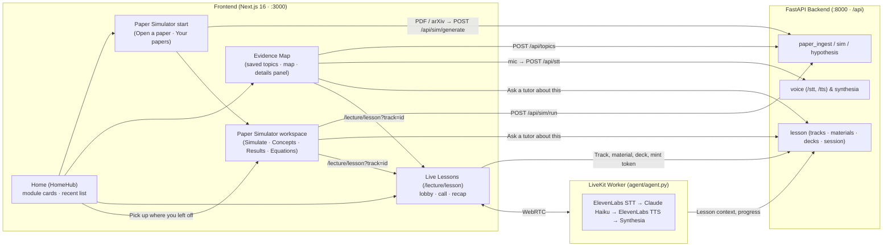

# Athena — System & UI Design

Athena is a multimodal AI research and learning workspace. It has three modules, **Live Lessons**, **Paper Simulator** and **Evidence Map**. Live Lessons is a live **Synthesia + LiveKit** avatar tutor with slides, a whiteboard and Circle-to-Ask. The other two modules hand off to it with **Ask a tutor about this**.

The names people see come from [modules.ts](frontend/src/modules.ts), together with each module's verb, description, call to action, icon, hue and landscape. The internal ids stay `lecture`, `paper2sim` and `hypothesis` (routes, storage keys, API modes). Never show an id as text; read the name from `MODULES`.

---

## 1. High-Level Architecture



---

## 2. Design Language: Meadow Glass

The visual system is **Meadow Glass**, defined in [globals.css](frontend/src/app/globals.css) (see its top comment). Motion and material guidance comes from [SKILL.md](SKILL.md) (Apple's fluid-interface principles, translated for the web). This section describes how the app uses both today.

### 2.1 Principles

- **One hue per module.** Every screen of a module uses its hue for the header icon, back-button hover, primary buttons and active tabs, so you always know where you are (§2.3). The hue comes from `MODULES[id].hue` / `.tone`.
- **Liquid glass over nature.** Every screen sits on a painted landscape ([Scene](frontend/src/components/nature/Scene.tsx)). Content and controls float above it as translucent glass layers. Each layer has a bright rim, an inner top highlight and a static diagonal sheen. Some also carry the opt-in lens rim (`glass-lens`). The header is a floating capsule, panes are floating sheets inset with ~10 px gaps, and single-line controls are capsules. Screen roots stay transparent so the landscape shows through.
- **No pointer-following light.** Glass does not react to the cursor position. It was removed on purpose; do not add it back. Hover feedback is the `st-sheen` sweep, a raised shadow or a small lift.
- **Calm surfaces, expressive entrances.** The expression comes from motion: things fade up in a stagger, graphs draw themselves, cards lift on hover, the segmented control's drop slides. The landscape stays still apart from slowly drifting pollen.
- **Ask a tutor about this.** The tutor is not in the header.
  - **Where the button appears:** only in the two inner workspaces. In the Paper Simulator it sits in the workspace bar next to the tabs. In the Evidence Map it sits in the footer lane under the map. In both places it never covers content.
  - **Where it does not:** Home, the Paper Simulator start screen and the Evidence Map start screen. Live Lessons is the lesson itself (`/lecture/lesson`).
  - **Click:** [AskTutorButton](frontend/src/tutor/AskTutorButton.tsx) and [askTutor.ts](frontend/src/tutor/askTutor.ts) reuse the learning track already made for that paper or map (same title and material ref), or create one with it as the material. A paper sends its concepts (else its model, equations and parameters); a map sends its claims with their supports / contradicts / open-question links written into each node's summary. Then it opens the lesson lobby on that track (`/lecture/lesson?track=<id>`), where the student picks a tutor and joins. While it works the capsule reads "Setting up your lesson…"; a failure shows a short reason under it.
- **Show the paper's meaning, not the plumbing.**
  - Math always renders, as KaTeX or Unicode.
  - Graph links say how things relate ("Agrees with", "Builds on", "Leaves open"), never a generic "governs".
  - A sidebar entry stays readable even when collapsed.
- **Speak only when asked.** The tutor and avatar stay silent until the user asks for help. Loading a paper or topic never triggers speech.
- **Every state is themed and accessible.** This holds in light, dark and high contrast, for colour-vision deficiency, with reduced motion and reduced transparency, and from a 390 px phone to a wide desktop.

### 2.2 Themes and tokens

The app has three themes, set as `data-theme` on `<html>`: **light** (default, meadow by day), **dark** (meadow at dusk) and **contrast**.
- [ThemeProvider](frontend/src/components/ThemeProvider.tsx) owns the state; the choice is stored in `scholartwin.theme.v2`.
- A `beforeInteractive` bootstrap script in [layout.tsx](frontend/src/app/layout.tsx) applies the theme before first paint.
- The **ThemeToggle** sits in every header. It is a [Segmented](frontend/src/components/glass/Segmented.tsx) control.

**Never hard-code colours.** Use tokens through Tailwind arbitrary values (`bg-[var(--bg-surface)]`) or inline `style`. For tints, use `color-mix(in srgb, <token> N%, transparent)`.

| Family | Tokens | Use |
| :--- | :--- | :--- |
| Backgrounds | `--bg-canvas`, `--bg-surface`, `--bg-surface-solid`, `--bg-surface-muted`, `--bg-glass`, `--bg-glass-elevated`, `--backdrop-field` | Warm paper base colour (the landscape fades into it); cards and panels (translucent thick glass, ~0.7); the opaque fallback; wells and inputs (a faint moss wash); thin glass bars; popovers; a soft fallback field on `body` for when the landscape is not painted |
| Glass | `--glass-rim`, `--glass-highlight`, `--glass-lowlight`, `--glass-specular`, `--glass-specular-2`, `--glass-blur`, `--glass-lens` | Rim border, inner top and bottom light, diagonal sheen, blur radius (0 in contrast), the lens rim's backdrop filter (`none` in contrast) |
| On the landscape | `--on-scene`, `--on-scene-soft`, `--scene-glow` | Text that sits straight on the landscape (page heads, the wordmark, section titles between sheets): ink, the soft moss second line, and a text glow that keeps it legible over the painting. Use the `on-scene` / `on-scene-soft` classes |
| Borders | `--border-subtle`, `--border-strong` | Default hairlines; emphasis, dashed empty states, hover |
| Text | `--text-primary`, `--text-secondary`, `--text-muted` | Text on glass. Each is ≥ 4.5:1 on canvas, surface and surface-muted in every theme |
| Accent | `--accent`, `--accent-hover`, `--accent-soft`, `--accent-border`, `--accent-fg` | Moss: primary actions and Live Lessons. `-fg` is the text colour on a solid fill of *any* module hue |
| Status | `--status-{support,contradict,gap,warning,link}` plus `-soft` and `-border` (and `--status-contradict-fg`) | Natural, CVD-safe semantics: **support** spruce teal, **contradict** clay, **gap** heather, **warning** wheat, **link** river (prerequisite / "builds on" links). Teal, clay and heather stay apart for protan, deutan and tritan vision; light-theme shades are dark enough to stay ≥ 4.5:1 on their own tint. The contrast theme uses brighter Okabe-Ito-style values |
| Elevation | `--shadow-card`, `--shadow-card-hover`, `--shadow-elevated`, `--hero-glow` | Cards, floating panels, a soft glow |
| Graph | `--xy-*` (mapped from the tokens above) | React Flow controls, edges and minimap follow the theme |

**The landscape.** [Scene.tsx](frontend/src/components/nature/Scene.tsx) paints three canvas layers once per size, theme and kind (far hills and sky, out-of-focus blossoms, foreground grass) with [paint.ts](frontend/src/components/nature/paint.ts), blurred by CSS for depth of field. Only the pollen layer animates, and not under reduced motion. `SceneProvider` in [layout.tsx](frontend/src/app/layout.tsx) renders it once as a fixed `.st-scene` at `z-index: -1`, so no screen needs a z-index of its own. Each screen picks its landscape with `useScene(kind, calm)`:
- `meadow` for Home and Live Lessons, `hills` for the Paper Simulator, `lake` for the Evidence Map. [page.tsx](frontend/src/app/page.tsx) picks it for Home, Paper Simulator and Evidence Map; the lesson page uses meadow.
- `calm` starts the fade into `--bg-canvas` higher, for screens dense with panels. Home is the only screen that isn't calm.
- The landscape is off in high contrast and under reduced transparency.

**Glass rules.**
- Text sits only on thick glass (`--bg-surface`, `apple-card`, `apple-sheet`, `apple-glass-elevated`), or straight on the landscape with `on-scene`. Never stack more than two glass layers over text.
- Don't put `backdrop-filter` or a transform on an element that contains `position: fixed` children, because it becomes their containing block and clips them. Cards and sheets therefore have no blur; only bars and popovers do.
- Never animate or leave a `filter` on a glass element (even `blur(0)`), because Chromium then stops rendering its backdrop blur. For the same reason, entrance animations use fill-mode `backwards`, never `both`/`forwards`: a held end transform stops the blur of popovers inside.
- Write only `backdrop-filter` in CSS; the build adds the `-webkit-` prefix, and writing both by hand made it drop the standard one.
- **`glass-lens`** is an opt-in refracting rim: a thin band at the edge refracts the scene brighter, like the rim of a water drop. It is a `backdrop-filter` on `::after` only, so the element itself never becomes a containing block. It needs a positioned element (add `relative` unless it is already absolute, sticky or fixed). Never combine it with `st-sheen` on the same element, because both use `::after`; put the sheen on an inner layer instead (as the Home cards do).
- **Reduced transparency** and **more contrast** swap every glass fill for `--bg-surface-solid` and hide the landscape and the lens rim.

**High contrast** turns glass into solid surfaces, removes blur, the landscape, the lens rim and the sheen, and makes borders opaque. It also thickens focus outlines.

### 2.3 Module hues and evidence colours

| Module / meaning | Token | Icon (lucide) | Landscape |
| :--- | :--- | :--- | :--- |
| **Live Lessons** (`lecture`) · primary actions | `--accent` (moss) | `GraduationCap` | meadow |
| **Paper Simulator** (`paper2sim`) · **supports** edges | `--status-support` (spruce teal) | `FlaskConical` | hills |
| **Evidence Map** (`hypothesis`) · **open question** edges (dashed) | `--status-gap` (heather) | `Network` | lake |
| **Contradicts** edges (dash-dot, so it doesn't rely on hue alone) | `--status-contradict` (clay) | | |
| **Builds on** / prerequisite edges | `--status-link` (river) | | |
| Warnings, pulsed nodes | `--status-warning` (wheat) | | |

Edge colours and dashes live in one place, `EDGE_PALETTE` in [GraphCanvas.tsx](frontend/src/components/GraphCanvas.tsx). Evidence counts always appear as a coloured swatch plus number, using the same colours and dashes. Examples are the Evidence Map count chips (which double as the legend) and the sidebar rows.

### 2.4 Typography

- **Font:** Geist and Geist Mono, self-hosted with `next/font` in [layout.tsx](frontend/src/app/layout.tsx) (`--font-geist`, `--font-geist-mono`), with the system SF stack as fallback. `html { font-size: 17.5px }`. Every `rem` is therefore 17.5 px, so use `px` where an exact pixel size matters (sidebar widths, for example).
- **Classes:**
  - `st-display`: large, light (weight 300), tight, balanced headings. Use it for the wordmark and page heads, usually two-tone: an ink line, then a second line in `on-scene-soft`.
  - `apple-display`: large tight titles on glass.
  - `apple-heading`: section and card titles.
  - `apple-label`: 10–11 px uppercase tracked labels.
  - Small uppercase mono kickers (the module verb or name above a page head) use `font-mono` with wide tracking.
- **Scale:**
  - The Home wordmark is `st-display` at `text-[clamp(64px,11vw,132px)]`.
  - Start-screen page heads are `st-display` at about `text-[clamp(34px,5.4vw,62px)]`.
  - Header titles are `text-sm` bold.
  - Body text is `text-xs`/`text-sm`.
  - Metadata is 10–11 px.
- **Text on the landscape** uses `on-scene` (ink plus `--scene-glow`) or `on-scene-soft`, never the `--text-*` tokens alone.
- **Math:**
  - [MathTex](frontend/src/components/math/MathTex.tsx) `Tex` / `RichText` render KaTeX, including `$…$`, `\(…\)` and auto-detected math in prose.
  - `prettyMath` turns LaTeX/ASCII into Unicode for places that can't hold markup: `<option>`, SVG, `title` and headers.

### 2.5 Surfaces, shape and elevation

| Class / component | Where |
| :--- | :--- |
| `apple-glass` | Thin glass with blur: the header capsule, floating legends, overlay captions, chips over content |
| `apple-glass-elevated` | Thick glass with blur: popovers, detail bubbles, the Open a paper dialog, sidebar peeks |
| `apple-sheet` | Floating panes that hold lists of text (sidebars, side panels, lists); thick glass, no blur |
| `apple-card` | Glass cards (Home module cards, tutor cards); hover raises the shadow |
| `glass-lens` | The opt-in refracting rim (§2.2): the header, Home cards, the segmented control, the tutor button, the call controls |
| [Segmented](frontend/src/components/glass/Segmented.tsx) | The liquid segmented control: a glass track whose selected option is a drop (`st-seg-drop`) that slides to the new choice and squashes a little while it moves. Arrow keys move between options. `kind="tabs"` gives `tablist`/`tab` roles; `kind="group"` gives pressed buttons. Used by the theme switch, the Paper Simulator tabs, the Evidence Map list tabs and the lesson stage/side panel |
| `apple-seg` / `apple-seg-on` | The recessed track and raised segment that `Segmented` builds on. A few hand-made uses remain (the Open a paper panel, concept details, the Equations nav); prefer `Segmented` for new controls |
| `apple-tint` | Tinted glass for the one primary action in a view. Set the hue with `--tint` (default `--accent`); text uses `--accent-fg` |
| `apple-press` | Every pressable control; it scales down on pointer-down for instant feedback |
| `apple-focus` | Every focusable control; visible focus ring (thicker in contrast) |

- **Radii:** Tailwind's scale is remapped in `globals.css`: `rounded-lg` 12 px, `xl` 16 px, `2xl` 22 px, `3xl` 28 px.
  - `rounded-full` (capsules) for single-line buttons, chips, inputs and tab tracks.
  - `rounded-[26px]` for floating sheets, cards and the header capsule; `rounded-[18px]`–`[22px]` for wells inside them.
- **Borders:** glass surfaces carry a 1 px `--glass-rim`, and wells and inputs `--border-subtle`. Hover moves a border to the module's `-border` token or to `--border-strong`.

### 2.6 Layout

**Header.** Every screen uses [AppHeader](frontend/src/components/AppHeader.tsx), a floating glass capsule (`apple-glass glass-lens`, `min-h-[52px]`, inset `mx-2 mt-2`, `rounded-[26px]`). It stays in normal flow (or `sticky` on scrolling start screens), so it never covers content. Hand-built bars are not allowed.

```
( [← Back] [module icon] Title / subtitle  ……  [Theme] [screen actions] )
```

- **Back button:** always first. Its label hides below `sm` (icon plus tooltip remain). It hovers in the module hue.
- **Actions:** screen actions use `HeaderAction`, whose labels collapse to icons below `lg`; an active action is `apple-tint` in the module hue. Theme labels hide below `xl`.
- **The tutor is not in the header.** It is the **Ask a tutor about this** button inside each workspace (§2.1).
- **Overflow:** the bar must never overflow, down to 390 px.
- **Home:** the header carries only the global controls. The **Athena** wordmark sits centre stage instead.

**Start screens** (Home, the Paper Simulator start screen, the Evidence Map before a search):
- A centred column that scrolls; the page head sits straight on the landscape in `on-scene` ink, and the controls below it are glass.
- Use `my-auto`, not `justify-center`, for vertical centring, so tall content scrolls instead of clipping.
- No ambient blobs or grids: the landscape is the backdrop.

**Workspaces** (Paper Simulator, Evidence Map results, the lesson call):
- `h-screen` with a fixed header. Panes are floating glass sheets inset with ~10 px gaps, and they scroll internally.
- **At `lg`+:** side-by-side panes with `grid-rows-[minmax(0,1fr)]` or a fixed-width side column.
- **Below `lg`:** panes stack, the area scrolls, and the canvas keeps a minimum height (`min-h-[380px]` or similar), so a graph can never collapse to 0 px.

**Collapsible sidebar** (Evidence Map saved topics):
- **Expanded:** 256 px, with **New topic** pinned at the top next to the collapse toggle.
- **Collapsed (`md`+):** a 124 px rail of descriptive mini cards: evidence-mix bar, short title (three lines), date. Hovering or focusing shows a full-title peek with counts.
- **Phones:** a 60 px icon rail. Expanding overlays the page instead of squeezing it.

### 2.7 Motion

All custom animations use the `st-` prefix, so one global rule switches them off under `prefers-reduced-motion`. Any state that depends on an animation needs a reduced-motion fallback: `.st-draw` is shown fully drawn, `.st-ping` is hidden.

| Class | Effect | Typical use |
| :--- | :--- | :--- |
| `st-fade-up` / `st-fade-down` | Enter from 16 px below or 10 px above | Content blocks, cards, list rows / headers |
| `st-rise` | Small rise and scale-in | Dense analysis rows (Paper Simulator tabs) |
| `apple-materialize` | Fade and scale in, no filter | Floating sheets and popovers |
| `st-float`, `st-bob` | Idle drift, bounce | Concept nodes, empty-state icons |
| `st-sheen` | Light sweep on hover | Cards, primary buttons (never on the same element as `glass-lens`) |
| `st-seg-drop` | Sliding, squashing drop | The selected option of `Segmented` |
| `st-progress` | Indeterminate bar | Uploads, topic search |
| `st-shake` | Short shake | Error messages |
| `st-draw`, `st-march`, `st-node-in`, `st-ping` | SVG path draw-in, marching dashes, node pop, pulse ring | Search progress, small illustrations |
| `st-reveal-x`, `st-grow-x` | Left-to-right reveal / bar growth | Charts, meters |

The aurora, grid, glow-border, pan, pop and twinkle keyframes still sit in `globals.css` but are no longer used; don't add new uses.

**Timing**
- **Easing:** `cubic-bezier(0.22, 1, 0.36, 1)` for entrances. Press feedback is about 100 ms; entrances 0.5–0.6 s.
- **Fill mode:** entrances use `backwards`, so nothing holds a transform after it arrives (§2.2).
- **Stagger:** 40–90 ms per item via `animationDelay`, with the first item delayed about 40–120 ms.
- **One `st-` animation per element.** Two such classes on one element overwrite each other's `animation`, so wrap the element instead.

**Graph camera** ([GraphCanvas](frontend/src/components/GraphCanvas.tsx), the Paper Simulator concept graph)
- A graph opens on the **whole chart**, or, for a saved Evidence Map topic, on the **last node clicked** (stored as `lastNodeId`). It never jumps to whichever node happens to be first.
- Clicking a node zooms to it and its neighbours, with `maxZoom` 1.1 so a lone node doesn't fill the screen.
- Pass fit options as **stable objects**: React Flow overwrites queued fits when given a new options object.

### 2.8 Component patterns

- **AppHeader / HeaderAction:** the shared bar and its action buttons (§2.6).
- **Home** ([HomeHub.tsx](frontend/src/components/HomeHub.tsx), [home/](frontend/src/components/home)):
  - The wordmark and tagline, with no hero buttons: the module cards are the way in.
  - Three module cards (`apple-card glass-lens`), each with its verb, name, description and call to action from `MODULES`, and a descriptive line drawing of what the module does ([ModuleArt.tsx](frontend/src/components/home/ModuleArt.tsx); theme tokens only, animated parts only without reduced motion). The sheen sweeps an inner layer because `glass-lens` owns the card's `::after`.
  - **Pick up where you left off** ([RecentList.tsx](frontend/src/components/home/RecentList.tsx), [lib/recent.ts](frontend/src/lib/recent.ts)): one newest-first list across all three modules. Papers come from the Paper Simulator library, evidence topics from the Evidence Map history (read only), and lessons from the backend's learning tracks (left out when the backend is down). A lesson row opens `/lecture/lesson?track=<id>`; an evidence row opens the Evidence Map on that topic (`initialTopicId`).
- **OpenPaperPanel** ([UploadModal.tsx](frontend/src/components/UploadModal.tsx), also exported as `NewConversationPanel`):
  - The `hero` variant is the larger panel on the Paper Simulator start screen; the `compact` variant is the **Open a paper** dialog in the workspace.
  - Both offer a drag-and-drop PDF zone (keyboard-operable) and an arXiv URL/ID field.
- **Paper Simulator start screen** ([LibraryView.tsx](frontend/src/components/LibraryView.tsx)): a page head (verb, name, description), then **Open a paper** beside **Your papers**. The same paper is listed once (`dedupeTopics`; `page.tsx` also dedupes when saving). Rows are `RecentRow`s; delete appears on hover or focus.
- **Evidence Map** ([HypothesisChatView.tsx](frontend/src/components/HypothesisChatView.tsx), [hypothesis/](frontend/src/components/hypothesis)):
  - **Before a search:** a two-tone page head on the landscape, then the glass question bar with mic and **Map it**, and starter questions under "Try one of these". On phones the question gets the first line and the mic and **Map it** wrap below it.
  - **During a search:** `SearchProgress` steps through the stages.
  - **With results:**
    - The map sits on one sheet and a 340 px side panel on another (stacked under the map below `lg`). There is no search bar: **New topic** in the saved-topics sidebar starts a search.
    - **Paper-level graph** ([model.ts](frontend/src/components/hypothesis/model.ts)): the nodes are **papers** and **open questions**. Claims are not nodes; they live inside their paper.
    - Two papers get one line when any of their claims support (teal) or contradict (clay, dash-dot) each other. A paper that builds on another gets a river line. An open question hangs off the paper whose claim raises it (heather, dashed). A paper with no links stands alone in a row at the bottom, greyed out.
    - Linked clusters are laid out top to bottom (dagre) and packed into rows.
    - The map's header holds the question and count chips for papers, supports, contradicts, builds on (when any) and open questions. The chips double as the legend.
    - Every claim belongs to a paper (`doc_id`, else the raw paper id older saves kept in `authors_year`, else the `c_<paper>_<n>` id; a missing paper gets a stand-in node). Paper nodes show "n claims · k linked".
    - **Details** ([Details.tsx](frontend/src/components/hypothesis/Details.tsx)): one component for whatever is selected. `NodeDetails` shows a paper (citation and "Open paper", its claims and what each links to: "Agrees with / Contradicts <paper> — <their claim>" with a "Why" button, or "Leaves open <question>") or an open question. `EdgeDetails` shows the claim pairs behind a line, the explanation and the quotes; "Back" returns to the paper. With nothing selected, `QuestionDetails` shows the topic's question.
    - On wide screens the details sit at the top of the side panel. On narrower screens they are a glass bubble docked to the bottom of the map. The header (tag, title, citation, list label) stays put; only the list scrolls. The zoom controls are top-left (`GraphCanvas` `controlsPosition`), so the details never cover them.
    - Below the details, [PaperList](frontend/src/components/hypothesis/PaperList.tsx) has three `Segmented` tabs, **Papers**, **Claims** and **Questions**, as flat lists. Clicking a row selects it on the map and shows its details; a claim shows its paper's details with that claim marked.
    - A footer lane under the map holds the hint and **Ask a tutor about this**.
    - Esc or clicking empty canvas clears the selection. Focus zooms leave room for the details.
- **Paper Simulator workspace** ([PaperSimTabsView.tsx](frontend/src/components/PaperSimTabsView.tsx), [papersim/](frontend/src/components/papersim)): the header shows the paper title with the module name as subtitle, and an **Open a paper** action. Below it, a workspace bar holds the `Segmented` tabs (thick glass with `glass-lens`, so the names stay legible over the landscape) and **Ask a tutor about this**.
  - **Simulate:** parameter cards with sliders, presets with "what to look for", a sweep panel, and one legend table per chart ([SeriesLegend.tsx](frontend/src/components/papersim/simulation/SeriesLegend.tsx)). Each series is named once with its swatch (colour and dash), and its key numbers (final or cursor value, min and max with where they occur, change against the latest pin) sit on the same row. Click a name to show or hide the series; hover a row to spotlight its curve.
  - **Concepts:**
    - Layered dagre layout; wide ranks wrap into rows of four.
    - Edges come out of node bottoms, with relation labels kept off nodes.
    - The read-only parameter details link back to the Simulate tab, the only place sliders live.
  - **Results:** per-series cards, statistics, insights, comparison and a data table.
  - **Equations:** sectioned with a scroll-spy navigation, rendered LaTeX, derivation steps and highlighted code.
- **Live Lessons** ([lecture/lesson/page.tsx](frontend/src/app/lecture/lesson/page.tsx), [tutor/shell/](frontend/src/tutor/shell)):
  - **Lobby** ([Lobby.tsx](frontend/src/tutor/shell/Lobby.tsx)): a two-tone page head on the meadow, tutor portrait cards (each with a "Hear …" voice sample), the learning track picker with materials and slide prep, a pre-join mic and camera check, and a progress panel ([TrackProgress.tsx](frontend/src/tutor/shell/TrackProgress.tsx), [progress.ts](frontend/src/tutor/shell/progress.ts)): where the last lesson stopped in the slides, when it was, and each knowledge point as Understood / Revisit / Next up. `?track=<id>` preselects a track once it is known to exist.
  - **Call** ([CallView.tsx](frontend/src/tutor/shell/CallView.tsx)): glass sheets over the meadow with the tutor's video tile, the stage (slides, whiteboard, shared screen) and side panel switched by `Segmented`, captions, and a glass control bar.
  - **Recap:** the lesson summary, polled until the agent posts it, and a downloadable transcript.
- **Feedback states:**
  - **Errors:** a contradict-tinted box with `AlertTriangle` and `st-shake`, and `role="alert"`.
  - **Status:** a warning-tinted box.
  - **Empty states:** a dashed `--border-strong` box with a `st-bob` icon and one line of guidance.
  - **Progress:** `st-progress` plus a status line with `aria-live`.

### 2.9 Accessibility checklist

- [ ] Text ≥ 4.5:1 (≥ 3:1 for ≥ 18.6 px or bold ≥ 14 px) in **all three themes**, including text on the landscape (use `on-scene`). Small coloured labels on a tint may need their colour pulled toward `--text-primary` with `color-mix`.
- [ ] Meaning never relies on hue alone: edges carry dash patterns; counts carry labels in tooltips.
- [ ] Every icon-only control has an `aria-label` and a `title`. Toggles expose `aria-pressed` / `aria-expanded`; the current item uses `aria-current`.
- [ ] Keyboard: everything clickable is a `button`/`a`, or has `role="button"`, `tabIndex=0` and Enter/Space handling, plus `apple-focus`. Segmented controls move with the arrow keys.
- [ ] Reduced motion leaves no element hidden or half-drawn, and stops the pollen. Reduced transparency turns glass solid and hides the landscape.
- [ ] No horizontal page scroll at 390 px; long titles truncate with a `title` tooltip.

---

## 3. Frontend Structure (`frontend/src/`)

### 3.1 Screens and navigation

The root route `/` ([page.tsx](frontend/src/app/page.tsx)) switches between client-side screens and picks each one's landscape with `useScene`:

```
type Screen = "home" | "library" | "papersim-workspace" | "hypothesis-chat"
```

1. **Home** ([HomeHub.tsx](frontend/src/components/HomeHub.tsx)): the Athena wordmark and tagline, three module cards, and the recent list (§2.8). Meadow.
2. **Paper Simulator start screen** (`library`, [LibraryView.tsx](frontend/src/components/LibraryView.tsx)): **Open a paper** and **Your papers**. Papers are kept in `localStorage` under `scholartwin.library.v1` via `useSyncExternalStore` to avoid hydration mismatches. Hills.
3. **Paper Simulator workspace** ([PaperSimTabsView.tsx](frontend/src/components/PaperSimTabsView.tsx)): four tabs (§2.8). Slider changes re-run the simulation through `POST /api/sim/run`; the latest request wins, and older saves recover their `sim_id` from the code hash. Hills.
4. **Evidence Map** ([HypothesisChatView.tsx](frontend/src/components/HypothesisChatView.tsx)): the saved-topics sidebar (topics stored under `scholartwin.hypothesis.history.v1`, including `lastNodeId`), the map and the details panel. `initialTopicId` opens a saved topic directly (from Home's recent list). Lake.
5. **Live Lessons** is its own route, `/lecture/lesson` ([lecture/lesson/page.tsx](frontend/src/app/lecture/lesson/page.tsx), components in `frontend/src/tutor/shell/`): the lobby, then the live call with slides, whiteboard and captions, then the recap. `?track=<id>` opens the lobby on that track (used by Home's recent list and **Ask a tutor about this**). Meadow.

### 3.2 API client and data adapters

- [client.ts](frontend/src/api/client.ts): the base URL comes from `NEXT_PUBLIC_API_URL` (`NEXT_PUBLIC_API_BASE` is kept as an alias), default `http://127.0.0.1:8000`.
- [endpoints.ts](frontend/src/api/endpoints.ts): typed wrappers for the `/api/*` endpoints. The lesson endpoints are in [tutor/shell/api.ts](frontend/src/tutor/shell/api.ts).
- [fixtures.ts](frontend/src/api/fixtures.ts): loads `/fixtures/*.json` for offline initialisation.
- [adapters.ts](frontend/src/api/adapters.ts): maps backend `Graph` and `SimSpec`/`SimOutput` onto the frontend `WorkspaceDataset`:
  - `graphToWorkspaceDataset`
  - `simSpecToWorkspaceDataset`
  - `simOutputToSeries`
  - `resolveSimId`

### 3.3 Tests

[vitest.config.ts](frontend/vitest.config.ts) runs every `src/**/*.test.ts(x)` in jsdom (`npm test`), with `src/tutor/test-setup.ts` as the setup file.

---

## 4. Backend API Design (`backend/app/`)

[main.py](backend/app/main.py) (`create_app()`) auto-discovers packages under `app.modules/*` and mounts each router under `/api`:

| Module | Key Routes | Purpose |
| :--- | :--- | :--- |
| `lecture` | `POST /api/ingest/lecture`, `GET /api/graphs/{graph_id}`, `GET /api/docs/{doc_id}/pages/{n}.png` | Lecture PDF ingestion, concept graph retrieval, and page rendering |
| `paper_ingest` | `POST /api/ingest/paper`, `GET /api/ingest/paper/{paper_id}` | Paper PDF / URL / arXiv ID ingestion |
| `sim` | `POST /api/sim/generate`, `POST /api/sim/generate-pdf`, `POST /api/sim/run`, `GET /api/sim/{sim_id}` | Paper Simulator: sandboxed simulation codegen (plus a second `sim.docs` call for the concept graph, equations and presets) and live parameter execution |
| `hypothesis` | `POST /api/topics`, `GET /api/papers/{paper_id}` | Evidence Map: multi-paper claim/gap graph generation |
| `ask` | `POST /api/ask-spatial/v2` | Spatial Circle-to-Ask reasoning with segmented UI annotations |
| `quiz` | `GET /api/quiz/{graph_id}/next`, `GET /api/quiz/{graph_id}/{node_id}`, `POST /api/quiz/{graph_id}/{node_id}/answer`, `GET /api/mastery/{graph_id}` | Adaptive MCQ generation and mastery tracking |
| `voice` | `POST /api/tts`, `POST /api/tts/segments`, `POST /api/stt`, `GET /api/media/{media_id}` | ElevenLabs TTS/STT and audio serving |
| `synthesia` | `POST /api/avatar/clips`, `POST /api/avatar/session`, `GET /api/avatar/clips/{clip_id}/video` | Synthesia avatar clip generation and playback |
| `lesson` | `GET /api/lesson/tutors`, `GET/POST /api/lesson/tracks`, `POST /api/lesson/tracks/{track_id}/materials`, `POST /api/lesson/tracks/{track_id}/deck`, `POST /api/lesson/session`, `GET /api/lesson/context/{lesson_id}` | Live Lessons: learning tracks and their materials, animated slide decks, LiveKit room token minting and agent dispatch, lesson memory for the agent |
| `presets` | `GET /api/presets`, `POST /api/presets/{name}/load`, `POST /api/presets/{name}/freeze` | Demo preset management |
| `health` | `GET /api/health` | Service health, cache mode, and active preset status |

**Slide decks** ([deck.py](backend/app/modules/lesson/deck.py)): one Claude call per track builds the deck through a `make_deck` tool. It uses `output_config.effort` `"medium"` with 32k max tokens; if the reply runs out of room before the tool call, the retry drops to `"low"`.

---

## 5. Live Lesson Worker (`agent/agent.py`)

[agent.py](agent/agent.py) runs as a LiveKit Agents worker (`TUTOR_AGENT_NAME`, default `scholartwin-tutor`), dispatched by `POST /api/lesson/session` with `{track_id, lesson_id, tutor_id}`:
- **Pipeline:** ElevenLabs STT → Anthropic Claude Haiku → ElevenLabs TTS → Synthesia avatar (voice only when `TUTOR_AVATAR=0` or the avatar can't join).
- **Lesson:** reads its tutor, track and the student's progress from `GET /api/lesson/context/{lesson_id}`, teaches from the track's slide deck and the shared whiteboard (RPC), answers Circle-to-Ask and "I'm lost" from the page, and writes progress, checkpoints and the recap back to `/api/lesson`.

The old tutor stack (`backend/app/modules/tutor`, `agent/avatar_agent.py`, the `/tutor` page and its floating tutor button, avatar tile and call hook) has been removed. Live Lessons is the only tutor.

---

## 6. Configuration & Runtime

- **Environment variables** ([settings.py](backend/app/settings.py), [.env.example](.env.example)):
  - The backend loads `<repo_root>/.env` and `backend/.env` via `pydantic-settings` (`load_settings()`).
  - The agent loads `agent/.env` first, then `<repo_root>/.env`.
  - The frontend reads `NEXT_PUBLIC_API_URL` (alias `NEXT_PUBLIC_API_BASE`).
- **Local startup** ([start.sh](start.sh)): starts FastAPI (`uv run uvicorn app.main:app --reload --port 8000`) and Next.js (`npm run dev` on `:3000`), with `trap` cleanup.
